<div align="center">



<br/>

**How one of India's original internet comedians thinks about attention, packaged as a Claude skill.**<br/>
Hand Claude a script, a hook or a page idea. Get it back built for watch time and the share button.

<br/>

[](#-install-in-10-seconds)
[](INDEX.md)
[](LICENSE)
[](https://github.com/Harshil-Jani/tanmay-bhat-content/stargazers)

[**Install**](#-install-in-10-seconds) · [**See it work**](#-see-it-work) · [**The 10 rules**](#-the-10-rules) · [**Sources**](INDEX.md) · [**Credits**](#-credits-and-disclaimer)

</div>

---

## ⚡ Install in 10 seconds

```bash
git clone https://github.com/Harshil-Jani/tanmay-bhat-content.git ~/.claude/skills/tanmay-bhat-content
```

That's it. Claude Code picks it up in every project, and loads it on its own whenever you plan,
script, hook or review content. Works with any Claude product that supports
[Agent Skills](https://docs.claude.com/en/docs/agents-and-tools/agent-skills/overview).

## 🎬 See it work

> **You:** Here's my reel hook. Run the Tanmay checklist on it.
> *"Hi guys! Today I'm going to show you 5 tips to make better coffee at home."*

<table>
<tr><th width="50%">❌ Before</th><th width="50%">✅ After</th></tr>
<tr>
<td>

*"Hi guys! Today I'm going to show you 5 tips to make better coffee at home."*

- Line one answers itself, so nobody needs the ending
- The best tip has no reason to wait for last
- Nothing surprising, nothing to send anyone

</td>
<td>

*"I spent ₹40,000 on coffee gear. The thing that actually fixed my coffee cost ₹90."*

- Opens a question only the last second answers
- The ₹90 reveal is held to the end
- Built to be **sent to a friend** who just bought an espresso machine

</td>
</tr>
</table>

Claude walks the same 8-point checklist every time:

```diff
+ Does line one create a question only the ending answers?
+ Is the best item or reveal last?
+ Is there one twist that beats the obvious expectation?
+ Does something change on screen every few seconds?
+ Which share is this built for: send-to-friend or post-to-profile? Which trigger?
+ Is this a proven topic in the niche, or a guess?
+ What is the angle: whose real curiosity or point of view is showing?
+ Could the comment section do this better than we can?
```

## 🧠 The 10 rules

| | Rule | In one line |
|:-:|---|---|
| 🎯 | **Retention is everything** | Write for the last second. Keep the screen alive. Save the reveal for the end. |
| 📤 | **Design for the share** | Pick send-to-a-friend or post-to-my-profile, then pick the trigger that earns it. |
| 📈 | **Start from proven demand** | Study the top 10 in your niche, start short, anchor on long-form. |
| 🔍 | **Find your angle** | Your style is the medium; your curiosity and point of view are the content. |
| 🔁 | **Reps beat talent** | Most drafts get binned. Loop count builds judgment, not years. |
| 🎲 | **Content is an asymmetric bet** | Small cost, uncapped upside. Keep a safe format next to every risky one. |
| 💸 | **Fit before money** | Enjoy it first, keep the job until a year of runway, price on value. |
| 🧑‍🤝‍🧑 | **Team and pitching** | Generate 20, shortlist 5, cut hard, test on a room that looks like the audience. |
| 🏢 | **Content for brands** | Always on, one in-house owner of taste, judged on more than direct return. |
| 🌱 | **Outlast the algorithm** | Plan as if you had to stop posting in two years. |

Every rule in [`SKILL.md`](SKILL.md) names the clip or talk it came from, so you can go back to
the source and hear him say it.

## 💬 Things to ask it

```text
"I'm starting a page about home coffee. Plan my first 10 videos the way Tanmay would."
"Is this hook built for send-to-friend or post-to-profile? Rewrite it for the other one."
"Here's our brand's content calendar. Where are we judging content only on direct return?"
"Cut this 90-second script to 30 without losing the payoff."
```

## 🤔 Who is Tanmay Bhat?


If you're outside India, you may not know the name. Inside India's internet, it is hard to miss.

Tanmay Bhat is an Indian comedian, writer, YouTuber and producer. He co-founded **All India
Bakchod (AIB)**, the comedy collective that helped turn Indian YouTube into a mainstream stage
for sketch comedy and satire. He judged the first season of Amazon Prime's stand-up competition
**Comicstaan** (2018), became an early livestreamer, and today spends much of his time advising
creators, founders and brands on content and marketing.

What makes him worth studying is the mix. Years in writers' rooms and on stage taught him what
holds a room, and he talks about content the way a growth team talks about a funnel: watch time,
shares, distribution, demand. This playbook is that second side of him, pulled out of podcast
and panel clips and turned into rules you can apply.

<br clear="right"/>

## 📦 What's inside

```
SKILL.md      the playbook and checklist Claude reads
INDEX.md      every source (20 Instagram clips, 33 YouTube talks), linked to the original
assets/       the banner and the photo used in this README
```

<details>
<summary><b>How it was built</b></summary>

<br/>

Each source clip and talk was transcribed, read in full, and the working rules were rewritten in
plain English, one commit per source, so the history shows exactly where every rule came from.
Transcripts stay local and are never published: the skill carries the ideas, not his words.

</details>

## 🤝 Contributing

Found a talk where he says something this playbook is missing, or a rule that misreads him?
[Open an issue](https://github.com/Harshil-Jani/tanmay-bhat-content/issues) with the link and
the timestamp. New rules need a source anyone can watch, and are written in your own words.

## 🙏 Credits and disclaimer

- **All ideas belong to Tanmay Bhat.** This is an unofficial fan project. It is not affiliated
  with, endorsed by or reviewed by Tanmay Bhat, his team, or the fan page the clips were found on.
- **Sources:** clips reposted by [@tanmaythinks_](https://www.instagram.com/tanmaythinks_/),
  excerpted from podcasts and panels credited in each post, plus full talks on YouTube (his
  channel *Honestly by Tanmay Bhat* and the shows that hosted him), each linked in
  [`INDEX.md`](INDEX.md). Watch the originals; they are better than any summary.
- **No transcripts are redistributed.** The playbook is written in our own words; `INDEX.md`
  only links to the original posts.
- **Photo:** "Tanmay Bhat" by All India Bakchod,
  [via Wikimedia Commons](https://commons.wikimedia.org/wiki/File:Tanmay_Bhat.png),
  licensed [CC BY 3.0](https://creativecommons.org/licenses/by/3.0/). Shown as published.
- **License:** the written playbook is [CC BY 4.0](LICENSE). Share it, adapt it, credit it.
- Tanmay, or anyone representing him, wants this changed or taken down? Open an issue and it
  will be done.

<div align="center">
<br/>

**If this made your next video better, a ⭐ helps other creators find it.**

</div>
